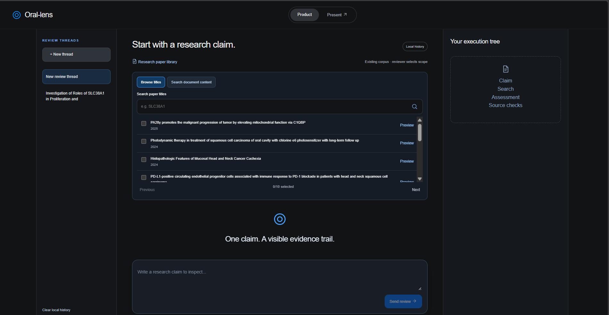
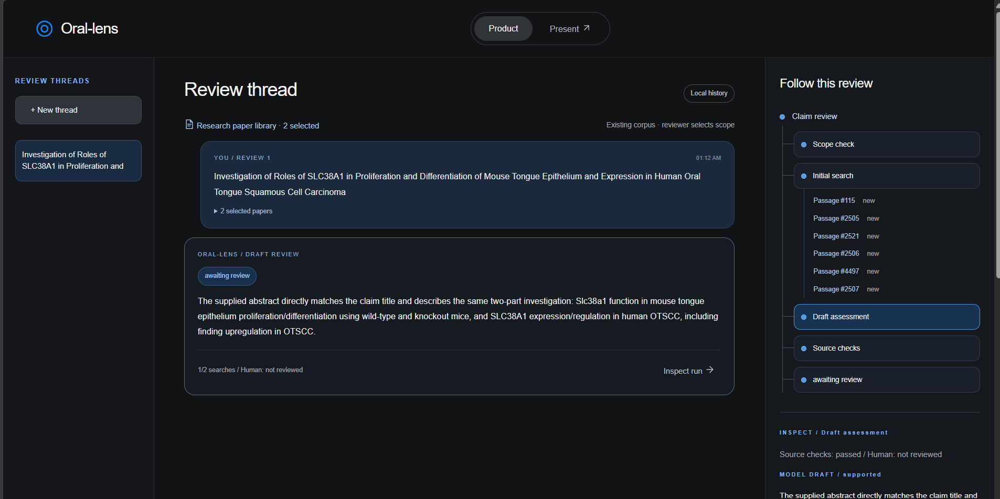
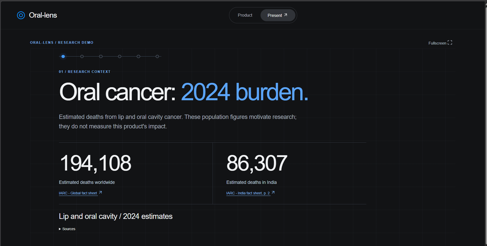
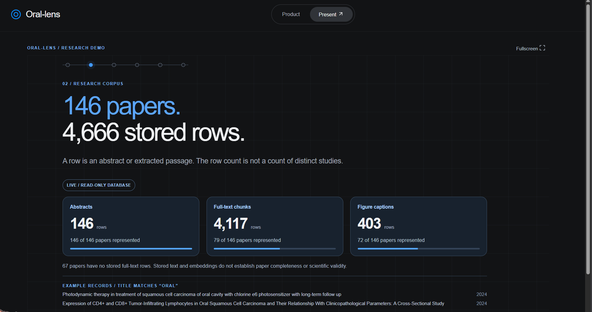
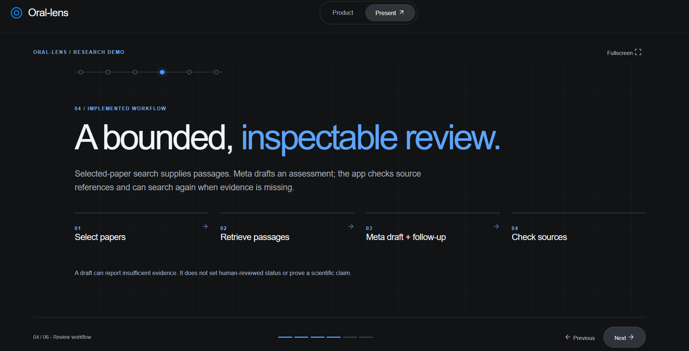
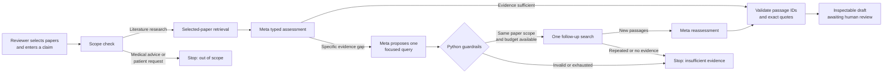
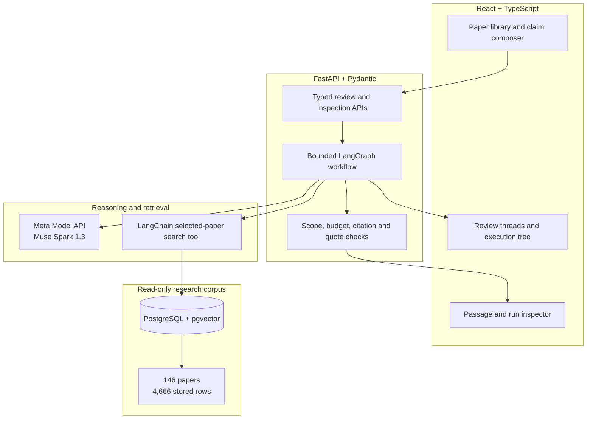

# Oral-lens

<div align="center">

### From a research claim to an inspectable evidence trail

**A Meta-powered literature-review workspace for oral cancer researchers and student reviewers.**

[](https://dev.meta.ai/)
[](https://fastapi.tiangolo.com/)
[](https://docs.langchain.com/oss/python/langgraph/overview)
[](https://react.dev/)
[](https://www.typescriptlang.org/)
[](https://github.com/pgvector/pgvector)

[Problem](#the-problem) · [Product](#see-the-product) · [Workflow](#how-a-review-works) · [Architecture](#architecture) · [Run locally](#run-locally) · [Evidence](#verification)

</div>

> [!IMPORTANT]
> Oral-lens supports **literature research**. It does not accept patient cases or provide diagnosis, screening, prognosis, treatment recommendations, or medical advice. Every model assessment is an unreviewed draft.

## The problem

A fluent literature answer can still overstate its sources. Reviewers must determine whether a claim is supported by the papers they selected, which exact passages support it, what information is missing, and whether a follow-up search found anything new.

Basic retrieval chat usually hides that process behind one answer box. Oral-lens keeps it visible:

- the reviewer chooses the paper scope;
- retrieval stays inside that scope and exposes uncovered papers;
- Meta returns a typed assessment with cited passage IDs and limitations;
- Python validates the cited IDs and exact quotations;
- one bounded follow-up search can target a specific evidence gap;
- repeated or unavailable evidence produces an explicit stopping reason;
- model assessment, mechanical source checks, and human review remain separate.

## See the product

### Browse the existing corpus and choose the scope

Reviewers can browse titles, search stored document content, preview stored excerpts, and manually select up to ten papers. Search suggestions never become evidence automatically.



### Follow the completed review

Each run is preserved as a browser-local thread. The execution tree exposes scope classification, searches, new passages, the Meta draft, source checks, and the terminal state. Selecting a node opens its real run data and source text.



<details>
<summary><strong>See the corpus inventory and presentation workflow</strong></summary>

The presentation starts with source-linked 2024 estimates for lip and oral cavity cancer. These population figures establish research context; they are not a measured outcome of Oral-lens.



The connected read-only corpus contains 146 papers and 4,666 stored rows. Row counts describe stored abstracts and extracted passages; they do not measure paper completeness or scientific validity.



The presentation mode explains the implemented review in four steps.



</details>

## How a review works



The model reasons about the claim and available passages. The application controls retrieval scope, call budgets, passage identity, validation, and terminal states. The graph performs at most **two searches and three Meta calls**.

### What the reviewer can inspect

| Layer | What Oral-lens shows | What it does not claim |
| --- | --- | --- |
| Retrieval | Exact stored excerpts, paper identity, source type, local passage ID | That similarity proves scientific relevance |
| Meta assessment | Support status, explanation, cited passages, limitations, evidence gap | That a model response is scientific truth |
| Source checks | Whether cited IDs exist and quotes occur in their referenced excerpts | That matching text semantically proves the claim |
| Human review | Explicit `not reviewed` or reviewer-controlled state | Automatic expert approval |

## Why Meta is central

Oral-lens uses **Muse Spark 1.3 through Meta Model API** for:

1. research-scope classification before retrieval;
2. JSON-schema constrained claim assessment;
3. identifying the exact missing information;
4. proposing a focused follow-up query; and
5. reassessing the claim after new passages are returned.

This is not a provider label on top of retrieval. Meta drives the evidence-gap decision inside the graph, while deterministic application code decides whether any proposed search is allowed and verifies the returned citations.

## Architecture



| Area | Technology | Responsibility |
| --- | --- | --- |
| Interface | React 19, TypeScript, Vite | Paper discovery, local threads, execution tree, evidence inspection, presentation mode |
| API | FastAPI, Pydantic | Typed request/response contracts and sanitized failures |
| Orchestration | LangGraph | Explicit nodes, conditional routing, and bounded follow-up |
| Retrieval tool | LangChain Core | Read-only search restricted to user-selected paper IDs |
| Model | Meta Model API, Muse Spark 1.3 | Scope classification, structured assessment, evidence-gap reasoning |
| Corpus | PostgreSQL, pgvector | Stored abstracts, full-text chunks, captions, and embeddings |
| Environment | uv | Reproducible Python dependency and command workflow |
| Visualization | Three.js | Themed rendering of the inherited 3D corpus projection |

## Hackathon contribution boundary

Transparent attribution is part of the product story.

| Inherited from the earlier Oral Cancer X project | Built during this hackathon |
| --- | --- |
| PostgreSQL/pgvector corpus and local paper data | Meta Model API client and structured-output contracts |
| Ingestion and embedding foundation | Selected-paper retrieval with coverage reporting |
| Original FastAPI foundation | Bounded LangGraph review and follow-up workflow |
| Historical UMAP/3D visualization data | Citation and exact-quotation validation |
|  | Explicit insufficient/repeated-evidence states |
|  | Shared CLI and review API |
|  | React paper library, review threads, execution tree, and evidence inspector |
|  | Themed in-page corpus view and presentation mode |

The pinned baseline, imported-file hashes, dates, classifications, and verification evidence are in the [contribution manifest](doc/contribution_manifest.md) and [import manifest](doc/import_manifest.json).

## Run locally

### Requirements

- Python 3.13 and [uv](https://docs.astral.sh/uv/)
- Node.js and npm
- PostgreSQL with pgvector and the configured corpus
- Meta Model API credentials

Create an ignored `.env` from `.env.example` and configure the database plus:

```dotenv
Meta_Muse_API_KEY=
Meta_Muse_MODEL=muse-spark-1.3
DB_READ_ONLY=true
```

Never commit the real `.env`.

### Start the backend

```powershell
uv sync --locked
uv run uvicorn app.main:app --reload --host 127.0.0.1 --port 8000
```

### Start the frontend

```powershell
cd frontend
npm.cmd ci
npm.cmd run dev
```

| View | Local URL |
| --- | --- |
| Product workspace | `http://127.0.0.1:5173/#product` |
| Presentation mode | `http://127.0.0.1:5173/#present` |
| FastAPI documentation | `http://127.0.0.1:8000/docs` |

Submitting a review uses Meta API credits. Do not enter patient information.

## CLI review

The CLI and HTTP API call the same workflow.

```powershell
# Browse papers
uv run python -m scripts.review_cli papers --limit 12 --search "tongue"

# Run an interactive review
uv run python -m scripts.review_cli review

# Validate input without the database or Meta API
uv run python -m scripts.review_cli review --check-only
```

## Verification

The latest repository checks establish covered software behavior, not clinical validity or scientific accuracy.

| Check | Verified result |
| --- | --- |
| Backend suite | **74 tests passed** |
| Frontend session state | History round-trip, interruption, corruption, scope snapshot, and tree checks passed |
| Frontend build | TypeScript and Vite production build passed |
| Connected corpus | Read-only inspection returned **146 papers / 4,666 rows** |
| Supported live path | One search, source checks passed, draft awaiting human review |
| Missing-detail live path | Two searches, repeated evidence detected, `no_new_evidence`, `insufficient_evidence` |
| Two-paper retrieval | Returned passages from both selected papers when the six-passage budget permitted |
| Content discovery | Exact SLC38A1 text match ranked before broader embedding suggestions |

Run the checks locally:

```powershell
uv run pytest -q

cd frontend
npm.cmd run test:session
npm.cmd run build
```

## Current limitations

- The application is demonstrated locally; no public hosted product is included.
- Review results are drafts and thread history is stored in the browser.
- Durable researcher corrections, structured study comparison, and reviewed export are future work.
- Stored excerpts do not provide verified PDF page or document-version provenance.
- Retrieval quality has not been established with an independently annotated scientific benchmark.
- The corpus, embeddings, and historical visualization foundation are inherited.

## Documentation

| Read this | For |
| --- | --- |
| [Submission package](doc/submission_package.md) | Form copy, three-minute demo flow, and final checklist |
| [Contribution manifest](doc/contribution_manifest.md) | New/inherited classification and verification history |
| [Workflow specification](doc/flow.md) | User, AI, validation, and failure flows |
| [Technology stack](doc/tech_stack.md) | Architecture and dependency decisions |
| [Product differentiation](doc/existing_product_diff.md) | Earlier project versus Oral-lens |
| [Interface validation](doc/interface_validation.md) | Recorded live paths and known failures |
| [Local setup](doc/local_setup.md) | Environment, database, and runtime instructions |
| [Meta setup](doc/meta_setup.md) | Provider configuration and smoke testing |
| [Hackathon rules](doc/hackathon_rules.md) | Supplied rules, judging rubric, and submission checks |

---

<div align="center">

**Oral-lens makes the boundary between a claim, its evidence, and its uncertainty visible.**

Research support only · Human verification required

</div>
