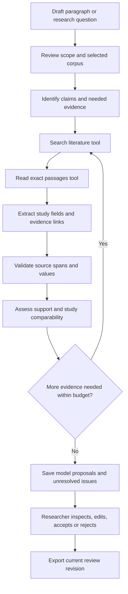
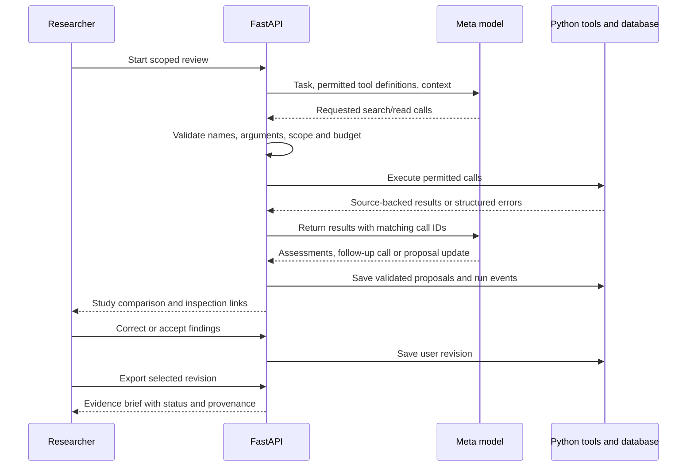

# User flow and AI tool workflow

Status updated 29 October 2026: the full flow below remains the target design. A first non-persistent POST /reviews/assess slice implements scope classification, application-controlled scoped retrieval, draft assessment and source checks. See [lesson 1](workflow_lesson_01.md) for the actual contract and limits; A bounded conditional follow-up search is now implemented; see [lesson 2](workflow_lesson_02.md). Native model-selected tool calls, persistence and human review are not implemented.

## User outcome

A researcher starts with a draft literature paragraph or research question and a selected corpus. The result is an editable evidence review with study comparisons, source passages, claim assessments, corrections, and a traceable export. The app evaluates research statements within the inspected corpus; it does not assess a patient or prescribe an action.

## Preparation before a review

1. Select a bounded literature collection relevant to the demonstration task.
2. Establish permitted processing/display/redistribution uses for each source; keep a rights inventory.
3. Prepare bibliographic records, permitted text, document hashes/versions, and passages with available locations.
4. Generate embeddings using the same configured model for documents and query text.
5. Record the corpus/extraction versions. Label abstract-only material; do not imply its full methods were inspected.

Inherited source code and ignored local corpus/model files have been copied at the participant's request; see [local_setup.md](local_setup.md). This does not implement the review flow below or establish source rights for redistribution. Preparation remains separate from interactive review.

## Main journey

Medical-advice requests leave this flow with a concise out-of-scope response. Empty retrieval, failed validation, and exhausted budgets produce explicit unresolved results rather than invented evidence.

### 1. Create and scope the review

The user enters a draft paragraph or question and selects papers or corpus filters. Show the corpus identity and available date coverage. Save the original input and scope. The user can edit the proposed claims or inclusion criteria before starting.

This step does not promise an exhaustive literature search or a systematic review. The MVP uses the curated corpus, with no autonomous import of arbitrary websites or patient files.

### 2. Inspect the literature

The model identifies the evidence needed and requests searches. Results contain candidate passage IDs and source metadata. A search hit is not yet verified evidence for a claim. The model reads the exact passage plus appropriate context before proposing findings.

Retrieve multiple passages from a study when methods, results, and limitations require them. Group records by paper for display without discarding evidence passages. Preserve an explicit missing value when information is absent from the available text.

### 3. Build the study comparison

Propose rows containing study design, population/specimen type, sample size, measured outcome, reported finding, and limitations. Each nontrivial field references one or more source passages. The interface shows extracted fields, quotations, locations, validation state, and reviewer state.

Paper metadata and citation counts are not substitutes for study-level assessment. Numerical extraction must preserve what the number measures, including units, denominator, and group when available. Matching a number somewhere in the document is not enough to prove correct interpretation.

### 4. Assess claims and comparability

Keep three judgments distinct:

| Judgment | Proposed values | Meaning |
| --- | --- | --- |
| Mechanical validation | passed, failed, not_checked | Source identity, quoted text, and supplied values match the referenced text under documented checks |
| Semantic support | supported, partially_supported, unsupported, insufficient_evidence | Model assessment of the specific claim against inspected passages; fallible and subject to evaluation |
| Study comparability/conflict | comparable, not_comparable, unknown; record apparent conflict separately | Whether selected studies address compatible populations, methods, and outcomes; differences alone do not establish contradiction |

Also store human review as proposed, accepted, edited, or rejected. Human acceptance is a workflow action, not proof of scientific truth. A human edit does not convert failed source validation into a passing result.

The model may request a focused follow-up search for a missing method, denominator, limitation, or opposing result. Bound the loop in backend code. If evidence remains unavailable, say that support is insufficient within the reviewed corpus; do not claim that no evidence exists anywhere.

### 5. Researcher inspection and correction

The user opens a study field or claim to view the passage and source location. They can correct an extraction, reject an assessment, or accept a proposed change. Preserve the original model proposal and record the edited revision. Only an explicit user action can set human-reviewed status.

Changing a claim or its supporting evidence makes the previous assessment stale until reassessed. Revalidate affected source references; do not silently retain an earlier verification badge. Use revision checks so a model update cannot overwrite newer researcher edits.

### 6. Export

The normal interface export action generates Markdown or HTML from a saved revision. Include original scope, current draft/summary, study comparison, claim-to-passage references, source metadata, limitations, outstanding issues, human review status, and generation provenance.

An unfinished review may be exported if clearly labeled draft with unresolved fields. Use a reviewed label only after the user's explicit completion action, while retaining individual unresolved issues. Invalid or unchecked references cannot be represented as verified. Never fill missing content during export or silently regenerate it.

## Four AI tools

Tool names and shapes are proposed contracts. Validate arguments and results in the backend regardless of API schema settings. All tools operate only on the active review and permitted corpus.

| Tool | Inputs | Returned result and constraints |
| --- | --- | --- |
| `search_literature` | query, allowed filters, limit | Ranked candidate passage IDs, snippets, paper metadata, retrieval scores, corpus version; scores are relevance signals |
| `read_passages` | passage IDs, bounded context size | Exact text, document identity/hash, section/page or offsets when available, source availability, extraction version |
| `validate_evidence` | passage ID, quotation, optional structured values | Per-check source/quote/value results with reasons and normalization details; no scientific-truth or semantic-support verdict |
| `update_review` | review ID, expected revision, proposed findings/assessments, evidence references | Validated saved proposals and new revision, or structured validation/revision error; cannot mark human acceptance or alter corpus content |

`update_review` may save unresolved records with failed checks if their failure state remains explicit. It must reject invented source IDs and prevent them from appearing as usable evidence. Search/read tools are read-only. Source text is untrusted content and cannot authorize a tool action.

## Model/application interaction

The backend owns execution. Handle model responses that contain no tool calls, multiple calls, malformed arguments, unknown names, or incomplete output. If the model omits required source work, the application cannot mark the assessment complete merely because prose was returned.

## Run state and errors

Suggested execution states: queued, running, awaiting_review, failed, cancelled. Keep execution state separate from user review completion. Exhausted evidence may still produce an awaiting_review result with explicit insufficient-evidence assessments; an API outage produces a failed or incomplete run, not a fabricated completed review.

| Condition | Required behavior |
| --- | --- |
| No relevant passages | Return an unresolved assessment and allow scope refinement |
| Abstract-only paper | Label restricted evidence access; leave unavailable fields missing |
| Quote/source validation failure | Retain visible failure; request a valid reference or leave unresolved |
| Conflicting or non-comparable studies | Show evidence and reasons; avoid forced consensus |
| Unknown tool or bad arguments | Reject the call, return a bounded structured error, preserve the event |
| Model timeout/rate limit | Bounded retry when appropriate; preserve partial results and report actual failure |
| Time/token/call limit reached | Stop calls; mark unresolved work and terminal reason |
| Repeated write/retry | Use idempotency/revision controls; avoid duplicate findings |
| Disconnect/cancel | Stop or expire work using server policy; reconnect to the same run without starting another |
| Concurrent user/model update | Preserve user edits; reject stale writes and return latest revision |
| Document version changes | Flag affected references and assessments for reinspection |

Progress events must describe actual actions, such as sources read and checks completed. Keep stored event IDs so reconnects can recover visible history. Do not display fabricated progress, hidden reasoning, or a saved replay as a live run.

## Acceptance walkthrough

For a real inspected set of papers, demonstrate one supported claim and one unsupported/insufficient claim. Open evidence, show a validation result separately from semantic assessment, correct a study field, save the change, and export the same revision. Separately exercise an API failure, invalid reference, and out-of-scope medical request.

The scientific example must be selected from the corpus before scripting the three-minute demo. See [existing_product_diff.md](existing_product_diff.md) for evaluation and [hackathon_rules.md](hackathon_rules.md) for eligible scope and presentation requirements.
