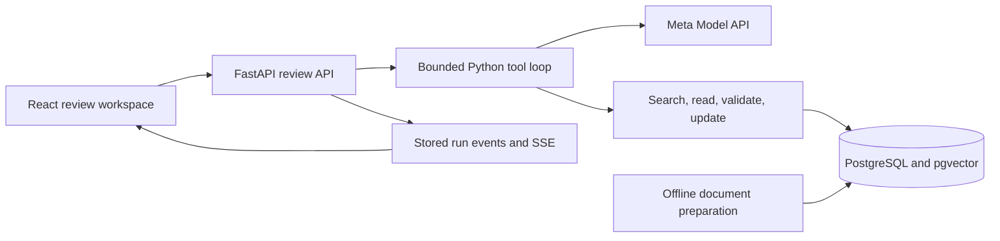

# Technology stack

Decision date: 27 October 2026. Status: inherited Python backend, local database setup, and a React/TypeScript/Vite frontend starter are present. The Meta review workflow, full review interface, migrations for new review entities, and deployment remain planned. See [local_setup.md](local_setup.md) and [frontend setup](../frontend/README.md) for commands and verification limits.

## Decision: keep FastAPI

The existing Oral Cancer X backend uses FastAPI, SQLAlchemy, PostgreSQL, and pgvector. Keeping those components reduces migration work and lets the new effort focus on passage provenance, AI tools, study comparison, and researcher edits.

FastAPI's typed validation and API-oriented structure fit the planned tool contracts and review endpoints. Django's built-in authentication and administration are useful capabilities, but the current workflow does not justify migrating the existing backend to obtain them. This is a project-specific choice, not a claim that Django cannot support AI workflows.

## Components

| Layer | Selection | Responsibility and status |
| --- | --- | --- |
| Backend | Python, FastAPI, Uvicorn, Pydantic | Inherited API and new read-only inspection present; review APIs/tool dispatch planned |
| Python project management | uv, pyproject.toml, uv.lock | Implemented dependency groups, existing .venv reuse, locked sync, and generated pip compatibility exports |
| Frontend | React, TypeScript, Vite, Three.js | Starter and Three.js/types installed; study table, claim panel, source viewer, reviewer edits, progress display, and React 3D scene remain planned |
| Styling | Tailwind CSS | Planned consistent layout and responsive components |
| Persistence | PostgreSQL with pgvector | Inherited schema/access and inspection helpers present; review/finding/event schema planned |
| Database access | SQLAlchemy and Alembic | Existing access pattern as reference; explicit migrations for the new schema |
| Embeddings | sentence-transformers with existing S-PubMedBERT-MS-MARCO model | Candidate reuse of embedding/search foundation; validate retrieval before adopting the old threshold |
| Document preparation | Existing ingestion stages and PyMuPDF | Conditional reuse; prepare permitted text and locations outside interactive review requests |
| AI inference | Meta Model API using its documented Python-compatible SDK interface | New runtime extraction, claim assessment, and function calling |
| Agent orchestration | One bounded Python tool loop | New allowlisted tools; application validates and executes every requested call |
| Progress | Server-Sent Events (SSE) | New actual run events streamed to the browser; saved state remains in PostgreSQL |
| Verification | pytest, annotated fixtures, frontend build/type checks | Setup pytest and frontend TypeScript/production build checks pass; evidence-quality benchmarks and browser rendering checks remain future work |
| Packaging | Docker; one application service plus PostgreSQL | Proposed repeatable local/deployment setup; hosting provider remains undecided |

The local setup uses Python 3.13 with uv-managed core dependencies and dev/ML/legacy/visualization groups. `pyproject.toml` and `uv.lock` are authoritative; requirements files are generated exports. See [uv_workflow.md](uv_workflow.md) and [local_setup.md](local_setup.md) for real commands. Import/startup checks do not establish compatibility of the inherited serialized UMAP artifact or prove embedding/model quality.

## Boundaries between components

The browser talks to our API. Credentials and model calls stay on the backend. The model requests functions; it does not receive direct SQL, filesystem, shell, or unrestricted network access. See [flow.md](flow.md) for tool contracts.

Use an asynchronous HTTP client for model calls. Keep blocking database/embedding/PDF operations off the asynchronous request loop, using compatible execution patterns or worker threads where appropriate. Precompute corpus embeddings and document extraction for the demo. An async route alone does not make CPU-heavy processing nonblocking.

## Meta integration

Use a small provider adapter so model selection, retries, request serialization, usage recording, and output parsing live in one place. Choose an account-accessible Meta model after a real capability check; a documentation example is not proof of access. Store the configured model ID with every run.

The documented OpenAI-compatible Python SDK is a transport option for calls to Meta's endpoint; it does not make OpenAI the inference provider. Preserve that distinction in code, documentation, and the submission.

Application-level Pydantic validation is required for tool arguments and generated records. API schema settings alone do not establish scientific correctness or remove the need for validation.

Each run records model ID, prompt version, source IDs, corpus version, usage when supplied, elapsed time, tool events, and completion/failure reason. Log actions and results, not hidden chain-of-thought. Avoid storing credentials or unnecessary sensitive content in logs.

## Proposed persistence model

These are conceptual records, not an implemented database schema:

- **Paper/document:** bibliographic ID, source URL, document version/hash, rights/provenance, full-text versus abstract-only availability.
- **Passage:** stable ID, document identity, source text, section/page or exact text offsets where available, embedding reference, extraction version.
- **Review:** question/draft, selected corpus and filters, revision, execution state, and reviewer completion state.
- **Study finding:** extracted field/value, source passage IDs, quotation, missing-information state, validation result, reviewer status.
- **Claim assessment:** original claim, supporting/opposing evidence references, semantic-support assessment, comparability, limitations, proposed revision.
- **Run/event:** model/prompt/corpus versions, tool call arguments/results, timestamps, usage, and terminal reason.

Preserve inherited source identity when importing data. Additional tables should reference it rather than silently overwriting the baseline. A stable passage ID must remain unambiguous across re-extraction and document versions.

## Deployment and reliability

For the MVP, Vite can produce static frontend assets served by the application service, alongside the FastAPI API. One public application origin simplifies browser routing. PostgreSQL is a separate persistent service. Verify that the chosen host supports the required pgvector extension and streaming behavior before committing to it.

Keep the curated corpus preprocessed. Long or interruption-prone ingestion remains a separate resumable command/job. Persist review progress and enforce per-run time, token, tool-call, and retry limits. Browser reconnection must not silently launch a second model run. More durable workers can be added if measured workload requires them.

Meta API access is not yet verified. The participant reported submitting the credit form; the supplied dashboard screenshot still showed no payment method and zero API keys. Do not assume credits are active or treat a billing notification as a hard spending cap. Database inspection is independently usable with PostgreSQL credentials and requires no model API key.

## Deliberate scope choices

Use one model-driven loop first. A larger agent framework, multiple agents, additional vector database, and separate search infrastructure require a demonstrated need. Markdown and HTML are the initial exports. Keep the new review workspace central to the demo; the inherited 3D explorer is background functionality.

## Technical references

- [FastAPI features](https://fastapi.tiangolo.com/features/)
- [FastAPI SSE](https://fastapi.tiangolo.com/tutorial/server-sent-events/)
- [Django overview](https://www.djangoproject.com/start/overview/)
- [Vite guide](https://vite.dev/guide/)
- [Meta quickstart](https://dev.meta.ai/docs/quickstart)
- [Meta tool calling](https://dev.meta.ai/docs/tool-calling)
- [Meta structured output](https://dev.meta.ai/docs/structured-output)

References were consulted during planning on 27 October 2026. Verify current API behavior and selected dependency versions during implementation.
