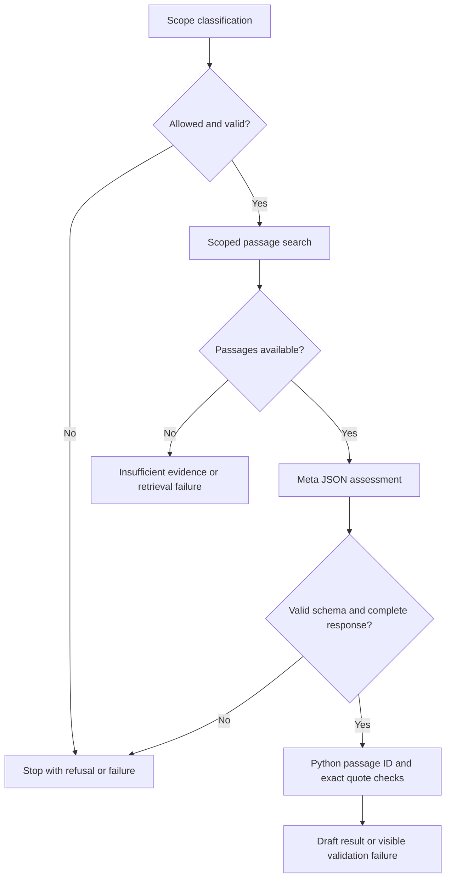

# Lesson 1: a bounded claim-review graph

The original single-search lesson below is historical. [Lesson 2](workflow_lesson_02.md) documents the current bounded follow-up extension and call limits.

Implemented 29 October 2026. This first slice is a local, non-persistent prototype; it is not the completed review product or an independently evaluated safety system.

## Your quiz answers

1. A node is a function. State includes the claim, selected papers, retrieved passages, assessment, errors and progress, rather than only the current step.
2. With no retrieved evidence, report insufficient evidence in the selected corpus. Do not substitute model memory or claim there is no evidence anywhere. Embeddings locate candidates; the original passage is the evidence inspected.
3. Correct: an exact quote match does not establish semantic support.
4. Correct: graph connections determine execution; Meta performs bounded classification and assessment.
5. Correct: source content must not alter permissions. Instructions plus application checks reduce risk; prompt-injection resistance is not proven by a prompt alone.
6. Human inspection matters because interpretation and extraction can be wrong. Human acceptance is a recorded review action, not clinical or scientific validation.

## Read the code in this order

1. [Schemas](../app/review_schemas.py): Pydantic validates external input and model JSON; extra fields are rejected. The model assessment schema has no human-approval field.
2. [Search](../app/review_search.py): LangChain Core's `@tool` wraps a Python function with a typed input schema. `.invoke({...})` validates arguments and calls it. In this version the application invokes it; Meta does not select tools. The SQL restricts candidates to selected paper IDs, uses a read-only transaction, and returns at most six matched excerpts through the graph.
3. [Workflow](../app/review_workflow.py): `ReviewState` is a TypedDict describing shared data. Each node copies the result and returns an update dictionary. `StateGraph` registers nodes; fixed and conditional edges control execution. `compile()` creates the executable graph; `invoke()` runs it.
4. [Route](../app/review_routes.py): FastAPI validates the request and calls the graph in a synchronous route, which runs outside the async event loop.
5. [Synthetic tests](../tests/test_review.py): fake retrieval and fake model completions exercise control flow without DB access, model downloads, or API credits.



The scope check uses one Meta request. Assessment uses at most one more. There are no retries, loops, arbitrary tools, SQL generated by a model, or model-controlled writes. Retrieval failure and empty retrieval are distinct. A provider or JSON failure cannot become a successful review. Returned events describe completed stages, not hidden reasoning.

The model is prompted for JSON, then Pydantic validates it. Native provider-enforced structured output and function calling are not yet integrated or verified. The existing Meta transport remains in use; no OpenAI key or provider is introduced. LangChain Core supplies the tool abstraction; the full `langchain` package is unnecessary for this slice.

## Try it locally

### Direct terminal command

From the repository root, list paper IDs without a model call:

```powershell
uv run python -m scripts.review_cli papers --limit 12
uv run python -m scripts.review_cli papers --search "histopathology"
```

Start an interactive review (prompts for claim and comma-separated paper IDs):

```powershell
uv run python -m scripts.review_cli review
```

Or provide arguments; replace the ID with a real one from the paper listing:

```powershell
uv run python -m scripts.review_cli review --claim "The selected studies used comparable specimen types." --paper-id "REAL_PAPER_ID"
```

Repeat `--paper-id` to include more papers. Use a request JSON copied from the interface with `uv run python -m scripts.review_cli review --request .\review-request.json`. Add `--check-only` to validate the request without database, embedding or Meta access; it does not check whether paper IDs exist.

The CLI calls the same Python workflow directly, so Uvicorn/frontend need not be running. Real review execution uses database/model configuration from the local environment and can consume credits or load the embedding model. JSON results go to stdout; progress/errors go to stderr. Exit codes: 0 for a returned draft/insufficient-evidence result or valid check-only input, 1 for execution failure, 2 for invalid input, 3 for out-of-scope, 130 for interruption. Exit 0 does not mean scientific correctness or human approval. No automatic retries or persistence are added.

### API/interface

Start `uv run uvicorn app.main:app --reload`, then open `http://127.0.0.1:8000/docs`. Use GET `/papers` to obtain real IDs. POST `/reviews/assess` accepts:

```json
{
  "claim": "Replace this with a specific literature claim to inspect.",
  "paper_ids": ["replace-with-an-existing-paper-id"]
}
```

Running this endpoint consumes Meta credits and can load/download the inherited query embedding model if not cached. It reads the selected research excerpts and sends bounded excerpts to Meta; never submit patient data. No DB schema or corpus writes occur. Results are not saved. Domain-level failure is returned in the result's `status` and `errors` even when HTTP status is 200; invalid requests return HTTP 422.

Inspect `assessment.support`, `source_validation`, and `human_review` separately. A mechanically valid citation may accompany an unsupported claim. A failed quote check remains visible, and its draft assessment must not be presented as verified. The model cannot change `human_review` from `not_reviewed`.

For an offline experiment, run `uv run --locked --offline pytest tests/test_review.py -q`. Read the quote-mismatch test and compare its result with the supported-draft test. No secrets or real papers are used by those tests.

## Limits and next lesson

Top-ranked similarity is not a validated relevance threshold. Ranking may miss useful material or overrepresent a paper. Excerpts are capped at 3,000 characters and explicitly flag truncation. A row ID and excerpt hash identify this local source snapshot, not a globally stable passage/document version. Page-level provenance is unavailable. The scope classifier and assessment prompts are fallible, and adversarial/medical-advice behavior has not been independently evaluated. Local tests demonstrate control flow, not real-world clinical safety or scientific accuracy. The route has no authentication/rate limiting and is intended for local development, not public deployment.

The participant reported a successful basic Meta smoke test (`muse-spark-1.3`, `MUSE_OK`, 33 total tokens, 2.97 seconds). The combined review workflow has not yet been exercised live against Meta and PostgreSQL. Persistence, researcher edits, native tool calling, structured study comparison, UI, export and quality evaluation remain future work.

Next: inspect a real scoped run, evaluate the retrieved excerpts, and verify structured-output/tool-calling capabilities before adding model-selected follow-up search.

References: [LangGraph Graph API](https://docs.langchain.com/oss/python/langgraph/graph-api) and [LangChain tools](https://docs.langchain.com/oss/python/langchain/tools), consulted 29 October 2026.

## Scope-check repair: 29 October 2026

A live reproduction of the participant's claim returned HTTP 200 with no visible text at the original 128-token scope budget. The same classification at 512 returned a valid literature_review decision, finish_reason stop, and usage of 264 completion / 136 prompt / 400 total tokens. Scope now allows 512 output tokens; no retries or bypass are added. The 128-token request could not produce visible output; the successful run demonstrates why visible JSON size alone is not a sufficient budget estimate. This verifies scope classification only, not combined live retrieval/assessment.

Failed results retain their errors and now include safe diagnostics with stage, a controlled error code and HTTP/finish metadata when available. Configuration, empty output, transport, malformed JSON and incomplete-output cases are distinguished without raw provider text, exception bodies or credentials. Invalid output still stops execution. Meta empty-output exceptions preserve finish_reason when supplied. Four regression cases were added; 58 offline tests pass.
