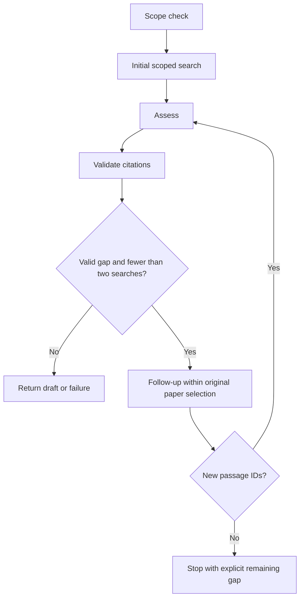

# Lesson 2: bounded follow-up retrieval

Implemented 29 October 2026. Builds on [lesson 1](workflow_lesson_01.md). No new dependencies, native model tool calling, checkpointing or database writes.

## What changed

An assessment can now propose a specific evidence gap and one focused search. Pydantic validates the decision; Python supplies the original paper selection and enforces the budget. LangGraph routes between Python nodes using the result state.



Errors and empty initial retrieval still stop explicitly. The graph permits at most two search attempts and three Meta calls: one scope classification and up to two assessments. Per-call output limits are 512 for scope and 1,500 for each assessment, without automatic retries. At most twelve 3,000-character excerpts enter the combined evidence set. This is bounded sequential execution; there is no streaming or durable run deadline/checkpoint yet.

## Code walkthrough

1. [Assessment schema](../app/review_schemas.py) adds `needs_more_evidence`, `missing_information` and `follow_up_query`. A true gap decision requires both specific text fields and a partial/insufficient support assessment. Extra fields such as proposed paper IDs are rejected. Older JSON without proposal fields defaults to no follow-up; the versioned prompt explicitly requests them.
2. [Workflow](../app/review_workflow.py) includes search count, search history, assessment history and terminal reason in the returned result. These are the working state exposed through its `result` field. The `validate` conditional edge routes to `follow_up_search` only after mechanical checks pass and while a search remains.
3. The follow-up node calls the existing LangChain search tool with the original request's paper IDs. A model proposal cannot replace them. Retrieval itself retains its SQL paper filter and read-only transaction.
4. Merge by passage ID. Existing IDs are not counted as new evidence; changed text/identity under an existing ID fails the run. Candidate similarity is a ranking signal, not additional scientific support. Different IDs may still contain overlapping or duplicate text; passage-ID deduplication is not a semantic independence check.
5. No new IDs means no further model assessment. Return `no_new_evidence`, the original assessment and explicit warning. Never claim the complete paper lacks the missing information. A successful search with new passages triggers assessment of the combined set, followed by fresh citation checks.
6. If the second assessment still requests evidence, return `search_budget_exhausted` and an insufficient-evidence execution status, while preserving the model's partial/insufficient support and missing-information fields. No third search is possible.

An output may have mechanically passing source checks while its evidence gap remains unresolved. Human review always stays `not_reviewed`. A failed second assessment retains the earlier proposal/history, but the overall result is failed and source checks are reset to `not_checked`; do not treat that prior proposal as a completed reassessment.

## Try it

```powershell
uv run python -m scripts.review_cli review
```

Select at least two related papers and inspect this claim: `The selected studies used comparable specimen types and outcome measures.` A follow-up is conditional, so it is not guaranteed for every prompt or evidence set. Check `search_count`, `search_history`, `assessment_history`, `stop_reason`, `warnings`, source checks and actual evidence. The interface also shows the search count and stop reason; raw JSON includes the full history. This command is a separate potentially billable run.

For deterministic offline learning:

```powershell
uv run --locked --offline pytest tests/test_follow_up.py -q
```

Read the no-new-evidence test first, then the successful reassessment test. Observe that changing the fake second search's result changes graph routing without changing any graph permissions.

## Verification and limits

Eleven new offline cases cover new evidence, repeated/empty follow-up results, the hard search budget, out-of-scope/changing passages, search failure, invalid model proposals and invalid citations. All 69 backend tests pass. These synthetic fixtures verify control flow, not retrieval quality or scientific assessment. The prior single-search user-supplied run succeeded live; the new two-search path has not been live-verified.

The model's proposed query is fallible. A filtered search cannot execute instructions or access other papers, but its usefulness and resistance to adversarial content require evaluation. No independent research-quality improvement, human-review persistence or submission readiness is established.
